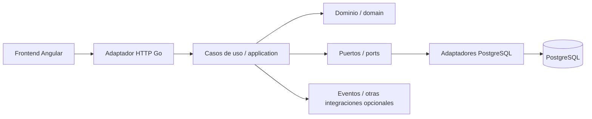

<div align="center">

# EDUTRAK · Backend

### API de seguimiento académico y acompañamiento tutorial

[](https://go.dev/)
[](https://www.postgresql.org/)


**[Organización](https://github.com/EDUTRAKMX)** · **[Frontend](https://github.com/EDUTRAKMX/EDUTRAK_FRONTEND)** · **[Figma](https://www.figma.com/design/6XQ9NdLBIaU6ncl1KT32LF/EDUTRAK?node-id=0-1)**

</div>

> **Aviso de alcance:** este README describe el backend **previsto** en las Unidades 1 y 2. Los módulos, estructura y migraciones no deben considerarse implementados, desplegados ni probados hasta que existan el código y sus evidencias en este repositorio.

## 1. Propósito

Desarrollar una API en **Go** que centralice la lógica de negocio de EDUTRAK: identidad, operación académica, sesiones de asistencia, calificaciones, justificantes, acompañamiento tutorial, alertas y auditoría. El sistema debe aplicar reglas de dominio, control de acceso, persistencia consistente y trazabilidad de acciones sensibles.

El frontend Angular consume esta API, pero la API debe verificar permisos y reglas por sí misma.

## 2. Stack y decisiones técnicas

| Responsabilidad | Tecnología / enfoque |
| --- | --- |
| Lenguaje | **Go**. |
| Diseño de servicio | **Monolito modular**, un desplegable con dominios separados. |
| Arquitectura por módulo | **Hexagonal (Ports & Adapters)**. |
| Protocolo de exposición | API HTTP/JSON; contratos y rutas específicos por definir. |
| Persistencia | **PostgreSQL**, migraciones versionadas y restricciones relacionales. |
| Autorización | **RBAC** y comprobación de acceso al recurso en backend. |
| Pruebas | Paquete estándar `testing`, dobles de puertos, integración con PostgreSQL aislado. |
| Integración continua | GitHub Actions, cuando estén configuradas las workflows. |
| Gestión | GitHub Flow y Jira. |

No se fija todavía un router HTTP, biblioteca de conexión, biblioteca de migraciones ni mecanismo exacto de tokens como decisión implementada; se registrarán en una decisión técnica cuando el equipo los seleccione.

## 3. Arquitectura: monolito modular + hexagonal

La aplicación se organizará en módulos de negocio. Cada módulo distingue:

- **`domain/`:** entidades, invariantes y reglas del negocio, sin depender de HTTP o PostgreSQL.
- **`application/`:** casos de uso y coordinación de operaciones.
- **`ports/`:** interfaces que describen servicios y repositorios necesarios.
- **`adapters/`:** implementaciones HTTP, persistencia PostgreSQL y otros mecanismos externos.



**Principio clave:** el dominio no importa dependencias de infraestructura. Una implementación de PostgreSQL satisface un puerto, pero el caso de uso depende del contrato, no de la base de datos concreta.

## 4. Módulos previstos

| Módulo | Responsabilidad |
| --- | --- |
| `identity` | Usuarios, roles, sesiones, contraseñas y autorización. |
| `academic` | Carreras, periodos, grupos, materias, unidades, inscripciones, asignaciones y horarios. |
| `attendance` | Sesiones de asistencia, QR dinámico, NFC opcional, captura manual, retardos y correcciones. |
| `grades` | Calificaciones decimales por unidad y clasificación NA/SA/DE/AU. |
| `justifications` | Solicitudes, evidencias, revisiones de Tutor y decisión final del Profesor. |
| `tutoring` | Observaciones, acuerdos y seguimiento individual. |
| `analytics` | Indicadores y alertas basados en datos explicables. |
| `audit` | Registro de operaciones sensibles y cambios de estado. |

## 5. Estructura del repositorio (propuesta)

Esta estructura se refiere al **repositorio independiente del backend**; no presupone un monorepo con Angular dentro.

```text
EDUTRAK_BACKEND/
├── cmd/
│   └── api/
│       └── main.go                    # Punto de entrada
├── internal/
│   ├── identity/
│   ├── academic/
│   ├── attendance/
│   ├── grades/
│   ├── justifications/
│   ├── tutoring/
│   ├── analytics/
│   └── audit/
│       # Cada módulo: domain/, application/, ports/, adapters/
├── migrations/                      # Migraciones versionadas, por implementar
├── config/                          # Configuración sin secretos
├── tests/
│   └── integration/                 # Pruebas con servicios aislados, si se requieren
├── .github/
│   └── workflows/
│       └── backend-ci.yml           # Propuesta de CI
├── .env.example                     # Solo ejemplos sin secretos
├── go.mod                           # Se creará al inicializar módulo
└── README.md
```

La estructura es una referencia de arquitectura, no un listado verificado de archivos actuales.

## 6. Modelo de datos PostgreSQL

La **propuesta de la Unidad 2** describe un modelo relacional de **23 tablas**, agrupadas en identidad, operación académica, asistencia, calificaciones, justificantes, tutoría, analítica y auditoría.

| Dominio | Tablas del esquema de referencia |
| --- | --- |
| Identidad | `users`, `roles`, `user_roles`, `auth_sessions` |
| Académico | `careers`, `academic_terms`, `subjects`, `curriculum_subjects`, `subject_units`, `groups`, `enrollments`, `teaching_assignments`, `schedules`, `subject_enrollments` |
| Calificaciones | `grades` |
| Asistencia | `attendance_sessions`, `attendance_records` |
| Justificantes | `justification_requests`, `justification_evidence`, `justification_reviews` |
| Tutoría | `tutoring_followups` |
| Analítica | `alerts` |
| Auditoría | `audit_logs` |

Se prevén claves primarias y foráneas, unicidad, `CHECK`, fechas coherentes y transacciones. Las restricciones **entre varias tablas** también deberán validarse desde casos de uso o mecanismos específicos de base de datos cuando corresponda.

**Pendiente:** incorporar el SQL de referencia a este repositorio, convertirlo en migraciones auditables, probar su aplicación/reversión y confirmar relaciones contra el DER y el diccionario de datos.

## 7. Reglas de dominio y casos relevantes

### Identidad y permisos

- Matrícula institucional de **8 dígitos**, única.
- Correo institucional `matricula@uttcampus.edu.mx`, único.
- Cambio de contraseña por el usuario y restablecimiento por el Administrador autorizado.
- Comprobar **rol y relación con el recurso**: un Profesor solo modifica sus asignaciones; un Alumno solo consulta su información.
- Auditar cambios sensibles y revocar sesiones cuando corresponda.

### Calificaciones por unidad

Las notas admiten **0.00 a 100.00**, con decimales. No se redondea el valor para definir categoría:

| Rango | Clasificación |
| --- | --- |
| `nota < 80` | **NA** |
| `80 <= nota < 90` | **SA** |
| `90 <= nota < 100` | **DE** |
| `nota == 100` | **AU** |

Casos límite prioritarios: **79.99, 80.00, 89.99, 90.00, 99.99 y 100.00**. Fuera de 0–100, rechazar la operación.

### Asistencia QR, manual y NFC

- El **Profesor** inicia/cierra la sesión asociada con grupo, materia, fecha y responsable.
- El **Alumno** registra su asistencia mediante QR dinámico desde su sesión autenticada.
- Validar inscripción, vigencia de la sesión, QR vigente, no duplicación y condiciones de red institucional.
- **No confiar únicamente en IP, encabezados del cliente o captura del QR** como prueba de presencia. Comprobar los datos desde servicios del servidor y un proxy confiable si aplica.
- El Profesor dispone de corrección/registro manual; NFC es **alternativa opcional**, condicionada por compatibilidad.
- Retardo estándar: **15 minutos** configurables; equivalencia estándar: **3 retardos = 1 falta** configurable.
- Resolver concurrencia y duplicados con restricciones y transacciones, además de validaciones del caso de uso.

### Justificantes

- Un Alumno solo solicita justificación sobre **una falta propia existente**.
- Admitir evidencias PDF/JPG/JPEG/PNG de **máximo 10 MB** por archivo; validar en servidor.
- Flujo previsto: **Alumno solicita → Tutor revisa/remite → Profesor decide**.
- Conservar responsable, comentario, fecha y estado de cada revisión.
- Las evidencias deben permanecer privadas y accesibles solo por autorización.

### Tutoría y analítica

- Registrar observaciones y acuerdos asociados con Tutor, Alumno y periodo.
- Generar alertas **explicables y basadas en registros**; no producir diagnósticos personales automáticos.
- Permitir consulta conforme a permisos y conservar trazabilidad de acciones relevantes.

## 8. Contratos con frontend

El repositorio [EDUTRAK_FRONTEND](https://github.com/EDUTRAKMX/EDUTRAK_FRONTEND) consumirá los recursos autorizados de la API. Antes de implementar cada módulo se documentarán sus contratos:

1. Método y ruta HTTP (sin publicar endpoints ficticios como reales).
2. Entradas, tipos, validaciones y ejemplos con datos sintéticos.
3. Respuestas, paginación/filtros y códigos de error.
4. Autenticación y permisos requeridos.
5. Casos de error y compatibilidad entre cambios de backend/frontend.

Los códigos **401** (no autenticado), **403** (prohibido) y **404** (no encontrado) deben utilizarse de forma coherente, protegiendo la privacidad del recurso.

## 9. Seguridad y privacidad

- Control de permisos en **cada caso de uso**, independientemente del frontend.
- Credenciales almacenadas como **hash seguro**, nunca en texto plano; tecnología concreta por seleccionar.
- Sesiones y revocación controladas; proteger datos de autenticación.
- Validación estricta de payloads, rangos, archivos, fechas y pertenencia a asignaciones.
- Almacenar evidencias privadas fuera de rutas de acceso público.
- Registrar acciones sensibles evitando volcar contraseñas, tokens o documentos en logs.
- No versionar `.env`, claves, respaldos con información personal ni expedientes reales.
- Usar datos **sintéticos** para pruebas y demostraciones.

## 10. Desarrollo local y configuración

**Pendiente de completar al inicializar el módulo Go y las migraciones.** No se han validado comandos de arranque sobre código real en este repositorio.

Deberán documentarse: versión de Go en `go.mod`, versión compatible de PostgreSQL, migraciones, variables de entorno de ejemplo (sin contraseñas), comando real de ejecución, endpoint de salud cuando exista y procedimiento de cierre/restauración de entorno local.

No tratar como ejecutables las rutas `cmd/api/main.go` o los archivos `migrations/` hasta que se creen.

## 11. Pruebas automatizadas (propuesta)

### Pruebas unitarias

Usar el paquete estándar **`testing`** y puertos simulados para probar la lógica sin necesitar una base real:

| Área | Casos prioritarios |
| --- | --- |
| `grades` | Límites NA/SA/DE/AU y valores inválidos. |
| `attendance` | Sesión cerrada, QR caducado, duplicados, inscripción y autorizaciones. |
| `identity` | Matriculas/correos únicos, acceso no autorizado y cambio de contraseña. |
| `justifications` | Falta existente, evidencia permitida y estados Tutor/Profesor. |
| `analytics` | Alertas justificadas por datos verificables. |

Ejemplos de ubicación futura:

```text
internal/grades/domain/classification_test.go
internal/attendance/application/register_attendance_test.go
internal/identity/application/authorize_test.go
internal/justifications/application/review_test.go
```

### Integración con PostgreSQL

Aplicar migraciones en una **BD aislada**, probar `FOREIGN KEY`, `UNIQUE`, `CHECK`, transacciones y casos de concurrencia. No usar bases con datos institucionales reales.

### GitHub Actions

Una vez inicializado el proyecto, se propone una workflow `.github/workflows/backend-ci.yml` que ejecute en PR hacia `main` y en `push` a `main`:

```bash
go vet ./...
go test ./... -race -coverprofile=coverage.out
go build ./...
```

Estos comandos son una **meta de automatización**: requieren `go.mod`, código y tests existentes; no se afirma que ya hayan pasado. Añadir control de formato con `gofmt` y publicar evidencias de CI según el entorno final.

**Meta interna sugerida:** 80 % de cobertura en reglas críticas; no es requisito de la rúbrica ni un resultado conseguido.

## 12. GitHub Flow y revisión de cambios

- `main`: rama estable con integración por PR.
- Ramas: `feat/<modulo>-<tema>`, `fix/<modulo>-<tema>`, `docs/<tema>`, `chore/<tema>`.
- Ejemplos: `feat/attendance-qr`, `feat/academic-groups`, `fix/grades-range`.
- Commits: `feat(attendance): add session validation`, `fix(grades): preserve decimal precision`, `test(identity): cover permissions`.
- Cada PR debe describir ticket/requisito, efectos sobre API/BD, pruebas, migraciones, riesgos y posibles cambios incompatibles.
- Revisión por otra persona cuando sea posible; preferir **Squash Merge** tras checks y conflictos resueltos.
- Migraciones destructivas requieren especial atención, respaldo y estrategia de reversión.

## 13. Estado y pendientes

- [x] Definición documental de módulos Go y arquitectura hexagonal.
- [x] Propuesta de modelo PostgreSQL con DER y diccionario de datos.
- [x] Reglas de asistencia, notas, justificantes y roles acordadas.
- [ ] Inicializar módulo Go y definir dependencias reales.
- [ ] Crear migraciones y probarlas en PostgreSQL.
- [ ] Implementar autenticación, permisos y operación académica.
- [ ] Implementar asistencias, calificaciones y justificantes.
- [ ] Incorporar pruebas unitarias, integración y GitHub Actions.
- [ ] Validar contratos extremo a extremo con Angular.

## 14. Equipo y enlaces

**Arquitectura, backend y seguridad:** Jaret Eduardo González Carrasco.  
**Asistencia e integración técnica:** Juan Pablo González Juárez.  
**Datos, analítica y QA:** Ernesto Herrera Martínez.  
**Interfaz y UX en integración:** Daniela Cabello González.

- [EDUTRAKMX](https://github.com/EDUTRAKMX)
- [EDUTRAK_FRONTEND](https://github.com/EDUTRAKMX/EDUTRAK_FRONTEND)
- [Diseños EDUTRAK en Figma](https://www.figma.com/design/6XQ9NdLBIaU6ncl1KT32LF/EDUTRAK?node-id=0-1)

---

**Proyecto académico de la Universidad Tecnológica de Torreón.** La documentación es una especificación de desarrollo, no una certificación de funcionalidades disponibles.
