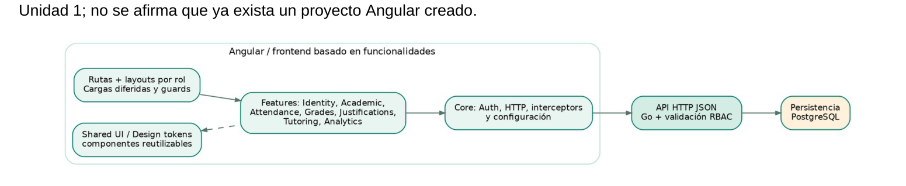
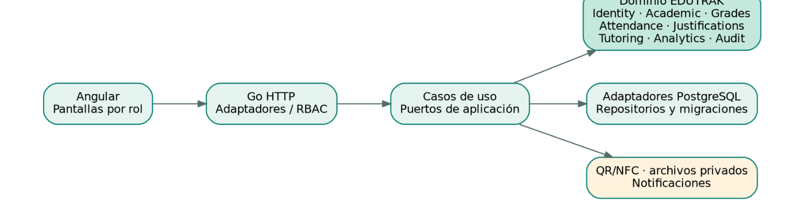
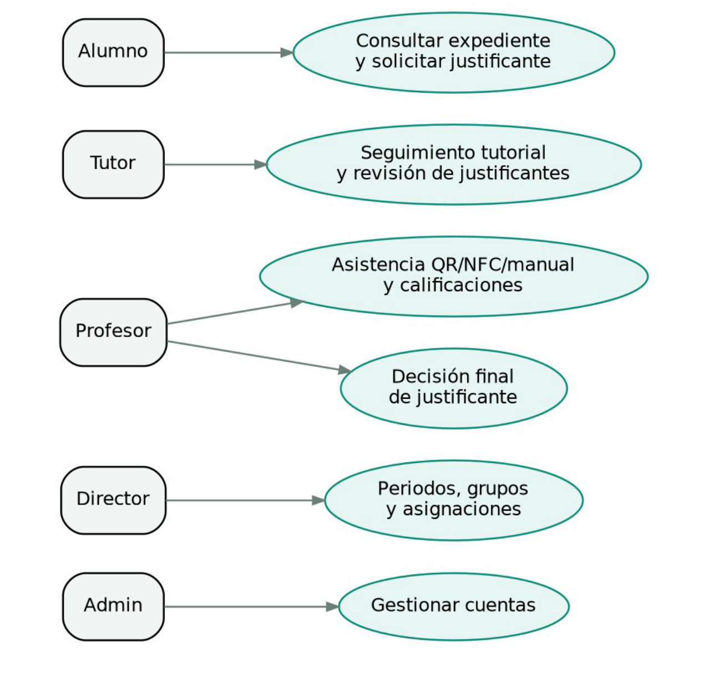
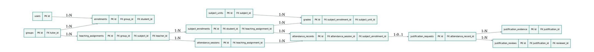
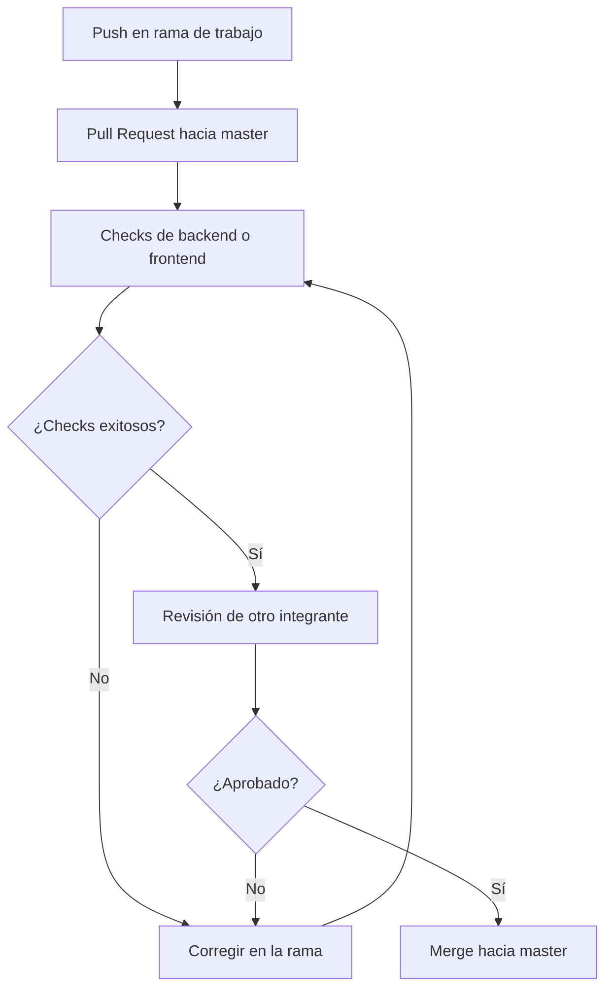

[UNIDAD_2.md](https://github.com/user-attachments/files/34986844/UNIDAD_2.md)
# EDUTRAK — Unidad 2: control de versiones, maquetado, diagramas y datos

## Ficha del proyecto

| Campo | Información |
|---|---|
| Institución | Universidad Tecnológica de Torreón |
| Programa | Ingeniería en Desarrollo y Gestión de Software |
| Asignatura | Desarrollo Web Profesional |
| Proyecto | **EDUTRAK — Plataforma Web de Seguimiento Académico y Acompañamiento Tutorial** |
| Docente | **MCC. Jesús Del Toro Robledo** |
| Grado y grupo | 8.º A |
| Actividad | Ampliación documental — Unidad 2 |
| Fecha de elaboración | 29/10/2026 |
| Integrantes | Jaret Eduardo González Carrasco (22170143); Juan Pablo Juárez González (23170112); Daniela Cabello González (23170179); Ernesto Herrera Martínez (23170202) |

La Unidad 2 amplía la [Unidad 1](UNIDAD_1.md) con criterios de prototipado, maquetado, control de versiones, diagramas, diccionario de datos, pruebas y evidencias del trabajo colaborativo.

## 1. Descripción y alcance de la Unidad 2

La Unidad 2 documenta las decisiones de EDUTRAK relacionadas con el diseño de interfaces, el trabajo colaborativo, la organización del código y la integridad de la información académica.

| Área | Contenido |
|---|---|
| Maquetado y prototipado | Diseño de interfaces por rol, sistema visual, navegación y criterios de adaptación a dispositivos móviles. |
| Control de versiones | Elección de Git y GitHub, repositorios del proyecto y convenciones de trabajo. |
| Colaboración y seguridad | Ramas de desarrollo, Pull Requests, revisiones, permisos y manejo seguro de información. |
| Diagramación | Arquitectura de la aplicación, casos de uso y relaciones de datos. |
| Modelo relacional | Organización de dominios, integridad y diccionario de 23 tablas PostgreSQL. |
| Documentación | Organización de las Unidades 1 y 2 y referencias desde el README del repositorio. |
| Calidad | Criterios de validación, pruebas e integración continua. |

La Unidad 2 presenta el diseño técnico y las convenciones del equipo. La implementación funcional y las comprobaciones de ejecución se documentan mediante las evidencias correspondientes a cada componente.

## 2. Maquetado y prototipado

### 2.1 Prototipo en Figma

La Unidad 1 documenta **45 pantallas de escritorio, 8 pantallas móviles y un sistema de diseño base**. Las pantallas representan el diseño del sistema, no una aplicación Angular ya ejecutable.

**Prototipo de referencia:** [EDUTRAK en Figma](https://www.figma.com/design/6XQ9NdLBIaU6ncl1KT32LF/EDUTRAK?node-id=0-1).

La cobertura comprende las funciones principales de Director, Profesor, Tutor y Alumno: autenticación, periodos, grupos, asistencias por QR/NFC/manual, calificaciones, justificaciones, seguimiento tutorial e indicadores.

### 2.2 Sistema visual

| Token | Valor documentado | Uso |
|---|---|---|
| Primario | `#029A7B` | Acciones principales y estados de éxito |
| Claro | `#6CC8B4` | Acentos suaves |
| Burgundy | `#8A2D40` | Identidad visual complementaria y alertas según diseño |
| Fondo | `#F6F8F8` | Superficies generales |
| Superficie | `#FFFFFF` | Tarjetas y formularios |
| Texto | `#17201F` | Lectura principal |
| Borde | `#D9E3E0` | Separadores y controles |
| Tipografía | Inter | H1: 32 px; H2: 24 px; cuerpo: 14 px; caption: 12 px |

### 2.3 Especificación del maquetado

- **Framework:** Angular, con pantallas, navegación, formularios y componentes reutilizables.
- **Semántica y accesibilidad:** usar `header`, `nav`, `main`, `section`, `form`, `table` y etiquetas asociadas a los controles cuando corresponda.
- **Responsive:** comprobar anchos móviles de 375–430 px y escritorio desde 1280 px, sin ocultar acciones ni información necesaria.
- **Calificaciones:** adaptar tablas a tarjetas o desplazamiento horizontal controlado en dispositivos pequeños.
- **Asistencia:** conservar visibles el método QR/NFC/manual, el estado de sesión, el cierre y los contadores.
- **Estados de UI:** contemplar sin datos, cargando, validación, 403, 404 y error.
- **Comprobación:** presentar capturas del Angular real, navegación por perfil y revisión visual frente a Figma.

### 2.4 Flujos principales de navegación

| Rol | Flujo | Restricción principal |
|---|---|---|
| Profesor | Grupos → sesión de asistencia → QR/NFC/manual → verificar → cerrar | Asignación vigente; registros no duplicados |
| Alumno | Materias → asistencia → falta → justificación → estado | Solo expediente propio; evidencia hasta 10 MB |
| Tutor | Alumnos → alertas → seguimiento → justificantes | Revisión previa a la decisión del Profesor |
| Director | Periodo → grupos → asignaciones → horarios → indicadores | Operación académica autorizada |

## 3. Sistema de versiones, repositorios y arquitectura Angular

### 3.1 Elección de Git y GitHub

**Git** permite registrar cambios, mantener ramas y recuperar versiones. **GitHub** centraliza repositorios remotos, Pull Requests, revisiones y evidencias de colaboración; permite relacionar el trabajo con tareas en Jira.

La separación entre frontend Angular y backend Go requiere controlar las versiones de cada componente y documentar los contratos de integración.

### 3.2 Organización real de los repositorios

EDUTRAK organiza el código en **dos repositorios independientes**:

| Repositorio | Tecnología | Enlace |
|---|---|---|
| Backend | Go, arquitectura hexagonal y PostgreSQL | [EDUTRAK_BACKEND](https://github.com/EDUTRAKMX/EDUTRAK_BACKEND) |
| Frontend | Angular | [EDUTRAK_FRONTEND](https://github.com/EDUTRAKMX/EDUTRAK_FRONTEND) |

La rama principal del backend es **`master`**. Los cambios de documentación se desarrollan en **`docs/backend`** y se integran a la rama principal mediante Pull Request.

```text
EDUTRAK_BACKEND/
├── README.md
├── cmd/                    # api, migrate, seed
├── internal/               # módulos y plataforma Go
├── migrations/             # migraciones PostgreSQL
├── docs/
│   ├── UNIDAD_1.md
│   ├── UNIDAD_2.md
│   ├── FRONTEND_INTEGRATION.md
│   └── assets/
│       ├── unidad1/
│       └── unidad2/
└── .env.example

EDUTRAK_FRONTEND/
└── ...                     # estructura Angular gestionada en su repositorio
```

La estructura es una referencia documental de las carpetas relevantes; no representa un inventario exhaustivo de archivos.

### 3.3 Arquitectura del backend

Se conserva el **monolito modular en Go con Arquitectura Hexagonal**. Los módulos son `identity`, `academic`, `attendance`, `grades`, `justifications`, `tutoring`, `analytics` y `audit`. Cada módulo separa:

1. `domain`: entidades y reglas de negocio.
2. `application`: casos de uso y coordinación.
3. `ports`: contratos que requiere la aplicación.
4. `adapters`: implementación HTTP, PostgreSQL u otras integraciones.

PostgreSQL es el sistema relacional de persistencia. La autorización de negocio se resuelve en el backend; ocultar controles en Angular no la reemplaza.

### 3.4 Arquitectura del frontend Angular

La organización propuesta es por **funcionalidades**, con componentes standalone, rutas con carga diferida, servicios HTTP y responsabilidades delimitadas.



*Figura U2-F1. Organización del frontend por funcionalidades y comunicación con API Go.*

```text
frontend/src/app/
├── core/               # autenticación, guards, interceptores, configuración
├── shared/             # componentes, estilos y utilidades reutilizables
├── layouts/            # navegación y estructura visual por rol
├── features/
│   ├── identity/
│   ├── academic/
│   ├── attendance/
│   ├── grades/
│   ├── justifications/
│   ├── tutoring/
│   └── analytics/
├── app.routes.ts       # rutas por funcionalidad y lazy loading
└── app.config.ts       # proveedores globales
```

| Capa | Responsabilidad y límites |
|---|---|
| `core` | Autenticación, sesión, interceptores y configuración; no depende de features. |
| `shared` | Elementos de presentación y estilos reutilizables; sin reglas específicas de negocio. |
| `layouts` | Estructura responsive y navegación por perfil. |
| `features` | Pantallas y servicios por proceso académico; dependencias controladas. |
| Comunicación | `HttpClient` e interfaces tipadas hacia la API REST en Go. |
| Estado | Signals para estado local cuando corresponda; RxJS para HTTP y asincronía. |

#### 3.4.1 Reglas de calidad frontend

- Los guards orientan la navegación; el backend valida permisos en cada operación.
- Formularios reactivos y validación de matrícula, correo, calificaciones y archivos de hasta 10 MB.
- Aplicar Inter, paleta y componentes visuales; comprobar resoluciones de 375, 390 y 430 px y escritorio.
- Conservar foco de teclado visible, mensajes de error legibles y áreas táctiles utilizables.
- Mostrar categorías NA/SA/DE/AU sin convertir Angular en la fuente autoritativa de la regla.
- Usar carga diferida para no descargar todas las funcionalidades de inicio.

La documentación de Angular establece los criterios de diseño e implementación; el repositorio del frontend concentra el código, las pantallas y sus verificaciones funcionales.

## 4. Workflow colaborativo, configuración y seguridad

### 4.1 GitHub Flow

| Elemento | Regla de trabajo |
|---|---|
| Rama principal | `master` en el backend. Los cambios se integran mediante Pull Request. |
| Ramas de trabajo | `feat/`, `fix/`, `docs/`, `test/`, `refactor/`, `chore/`, `hotfix/`. |
| Commits | Conventional Commits (`feat:`, `fix:`, `docs:`, `test:`, etc.). |
| Pull Request | Describir cambio, motivo, requisitos, pruebas y evidencias; solicitar revisión. |
| Revisión | Preferir aprobación de al menos una persona distinta del autor. |
| Integración | Resolver conflictos y checks; preferir *squash merge* cuando corresponda. |
| Seguridad | Prohibido subir secretos, credenciales, evidencias privadas o datos reales de alumnos. |

**Convención de ramas:** `<tipo>/<modulo>-<descripcion-corta>`, en minúsculas y kebab-case. Ejemplos: `feat/attendance-dynamic-qr`, `fix/grades-boundaries`, `docs/backend`.

**Convención de commits:** `<tipo>(<alcance>): <descripcion>` o `<tipo>: <descripcion>`.

| Ejemplo | Propósito |
|---|---|
| `feat(attendance): add QR session validation` | Función nueva |
| `fix(grades): preserve decimal score boundaries` | Corrección |
| `test(attendance): cover duplicate registration` | Pruebas |
| `docs(database): describe attendance relations` | Documentación |
| `refactor(identity): extract session port` | Refactorización |
| `ci(frontend): run tests on pull requests` | Integración continua |
| `chore(repo): update ignore rules` | Mantenimiento |

Los commits en español son válidos siempre que el equipo mantenga un criterio consistente.

### 4.2 Configuración inicial de Git

```bash
git config --global user.name "Nombre Apellido"
git config --global user.email "correo-propio"
git config --global pull.rebase false
git status
git remote -v
```

En equipos Windows, `core.autocrlf` se configura conforme a la política acordada. La rama inicial de repositorios nuevos se determina por su configuración, sin renombrar automáticamente la rama `master` existente del backend.

### 4.3 Seguridad del repositorio

- Autenticación por SSH o credenciales de acceso autorizadas y autenticación en dos pasos (2FA).
- Acceso mínimo necesario según el rol del colaborador.
- Ignorar `.env` y otros archivos de secretos, `node_modules/`, `dist/`, `.angular/`, binarios, logs y archivos temporales; mantener `.env.example` únicamente con valores ficticios.
- Solicitar PR y revisión antes de fusionar; bloquear `force push` cuando los permisos del repositorio lo permitan.
- Versionar migraciones y revisar su compatibilidad, respaldo y reversión.
- No publicar expedientes, justificantes ni información personal real en Git.

Las reglas de protección de ramas se administran en GitHub según los permisos disponibles. Las revisiones entre colaboradores quedan registradas en los Pull Requests.

### 4.4 Responsabilidades del equipo

| Integrante | Responsabilidad |
|---|---|
| Jaret | Arquitectura, backend, seguridad y coordinación de PR |
| Juan Pablo | Integración de asistencia QR/NFC y contratos frontend/backend |
| Daniela | Maquetado Angular, experiencia de usuario y consistencia con Figma |
| Ernesto | Modelo de datos, migraciones, calidad y comprobación de restricciones |

### 4.5 Política de Pull Requests

1. Crear una rama desde la principal actualizada y realizar commits de un mismo propósito.
2. Abrir un PR con título descriptivo, tarea de Jira o requisito RF/RNF y explicación del cambio.
3. Adjuntar capturas para interfaces; indicar impacto en API/BD, pruebas y posibles riesgos.
4. Solicitar revisión a otro integrante; atender cambios solicitados.
5. Ejecutar verificaciones disponibles y corregir fallos antes del merge.
6. Integrar mediante el flujo acordado, preferentemente *squash merge*; conservar el enlace al PR.

Los cambios urgentes deben mantener trazabilidad y revisión en la medida de lo posible.

## 5. Diagramas del sistema

### 5.1 Arquitectura y dependencias



*Figura U2-1. Frontend Angular, adaptadores Go, casos de uso, dominio y persistencia PostgreSQL.*

La regla de dependencia de Arquitectura Hexagonal apunta hacia el dominio. Las entidades no dependen de HTTP, SQL ni de la interfaz Angular.

### 5.2 Casos de uso por rol



*Figura U2-2. Actores y operaciones relevantes de EDUTRAK.*

El Alumno consulta su expediente y solicita justificantes; el Tutor registra seguimiento y revisa solicitudes; el Profesor opera asistencia y calificaciones y resuelve justificantes; el Director administra periodos y grupos; el Administrador mantiene cuentas.

### 5.3 Diagrama entidad–relación (relaciones principales)



*Figura U2-3. Relaciones principales y claves PK/FK del modelo EDUTRAK.*

El DER completo de **23 entidades únicas** se documentó en la Unidad 1. `subject_units` es una sola tabla lógica aunque aparezca más de una vez en vistas gráficas del modelo.

## 6. Modelo relacional y reglas de integridad

### 6.1 Organización por dominios

| Dominio | Tablas |
|---|---|
| Identidad | `users`, `roles`, `user_roles`, `auth_sessions` |
| Catálogo académico | `careers`, `academic_terms`, `subjects`, `curriculum_subjects`, `subject_units` |
| Operación académica | `groups`, `enrollments`, `teaching_assignments`, `schedules`, `subject_enrollments` |
| Calificaciones | `grades` |
| Asistencia | `attendance_sessions`, `attendance_records` |
| Justificaciones | `justification_requests`, `justification_evidence`, `justification_reviews` |
| Tutoría | `tutoring_followups` |
| Analítica | `alerts` |
| Auditoría | `audit_logs` |

### 6.2 Relaciones principales

- Una carrera puede contener grupos; una materia se relaciona con varios planes a través de `curriculum_subjects`.
- Un periodo contiene grupos; cada grupo vincula tutor, inscripciones y asignaciones docentes.
- `teaching_assignments` vincula grupo, materia y Profesor; cada asignación puede tener varios horarios en `schedules`.
- Cada `subject_unit` pertenece a una materia; las calificaciones vinculan unidad e inscripción a materia.
- Cada sesión de asistencia corresponde a una asignación docente; cada registro a un alumno inscrito.
- Las solicitudes de justificación se relacionan con una ausencia y contienen evidencias y revisiones.
- Seguimientos y alertas se vinculan a alumnos y periodos; auditoría registra el actor y la operación.

### 6.3 Reglas de datos

- Matrícula institucional de ocho dígitos y correo de patrón `matrícula@uttcampus.edu.mx`; ambos únicos.
- Calificación `NUMERIC(5,2)` de 0.00 a 100.00: NA menor a 80; SA de 80 a menos de 90; DE de 90 a menos de 100; AU igual a 100, sin redondear.
- QR temporal, sesión vigente, alumno autenticado e inscrito y red autorizada; no se confía en IP proporcionada por el cliente.
- Un registro por alumno y sesión; retardo inicial de 15 minutos y equivalencia estándar de tres retardos por falta, configurables.
- Solo una ausencia existente puede justificar una falta; el Tutor revisa antes de la resolución del Profesor.
- Evidencias PDF/JPG/JPEG/PNG, con máximo de 10 MB por archivo y almacenamiento privado.
- Auditoría mínima: actor, acción, tipo e ID de entidad, fecha y metadatos sin secretos.

### 6.4 Normalización y consistencia

Los catálogos, relaciones N:M y registros de operación están separados para reducir redundancia y preservar integridad. El diseño busca una estructura mayoritariamente equivalente a tercera forma normal (3FN), sin afirmar una demostración formal de todas las dependencias funcionales.

Deben comprobarse las relaciones cruzadas que no quedan garantizadas únicamente por FK simples: inscripción al grupo, unidad perteneciente a la materia, coincidencia de asignación en asistencia, estados justificables y permisos en las transiciones. Las restricciones de negocio se verifican en casos de uso y pruebas de integración.

## 7. Diccionario de datos de EDUTRAK

El diccionario describe las **23 tablas lógicas del modelo** con tipos PostgreSQL. `PK`: llave primaria; `FK`: llave foránea; `NN`: `NOT NULL`; `UQ`: único. Las migraciones versionadas del backend establecen la definición del esquema desplegado.

### 7.1 `users`

Cuentas y datos de identidad de usuarios.

| Campo | Tipo | Restricción | Descripción |
|---|---|---|---|
| id | UUID | PK | Identificador interno del usuario |
| institutional_number | VARCHAR(8) | NN,UQ | Matrícula de ocho dígitos, cuando aplique |
| given_names | VARCHAR(120) | NN | Nombre(s) |
| paternal_surname | VARCHAR(80) | NN | Apellido paterno |
| maternal_surname | VARCHAR(80) | — | Apellido materno |
| email | VARCHAR(180) | NN,UQ | Correo institucional |
| password_hash | VARCHAR(255) | NN | Hash de contraseña, nunca texto plano |
| profile_photo_url | TEXT | — | Referencia a imagen de perfil |
| street | VARCHAR(150) | — | Calle (dato opcional) |
| exterior_number | VARCHAR(20) | — | Número exterior |
| interior_number | VARCHAR(20) | — | Número interior |
| neighborhood | VARCHAR(120) | — | Colonia |
| postal_code | VARCHAR(10) | — | Código postal |
| curp | CHAR(18) | — | CURP opcional de acuerdo con finalidad y autorización |
| is_active | BOOLEAN | NN,DEFAULT TRUE | Cuenta habilitada |
| created_at | TIMESTAMPTZ | NN,DEFAULT NOW() | Fecha de alta |
| updated_at | TIMESTAMPTZ | NN,DEFAULT NOW() | Última actualización |

### 7.2 `roles`

Catálogo de roles y permisos.

| Campo | Tipo | Restricción | Descripción |
|---|---|---|---|
| id | SMALLINT | PK | Identificador del rol |
| code | VARCHAR(30) | NN,UQ | ADMIN, DIRECTOR, TEACHER, TUTOR, STUDENT |
| name | VARCHAR(80) | NN | Nombre visible |

### 7.3 `user_roles`

Relación entre usuarios y roles.

| Campo | Tipo | Restricción | Descripción |
|---|---|---|---|
| user_id | UUID | PK,FK → users.id | Usuario asignado |
| role_id | SMALLINT | PK,FK → roles.id | Rol asignado |

### 7.4 `auth_sessions`

Sesiones autenticadas.

| Campo | Tipo | Restricción | Descripción |
|---|---|---|---|
| id | UUID | PK | Identificador de sesión |
| user_id | UUID | NN,FK → users.id | Propietario de sesión |
| refresh_token_hash | VARCHAR(255) | NN | Hash del token de renovación |
| expires_at | TIMESTAMPTZ | NN | Vencimiento |
| revoked_at | TIMESTAMPTZ | — | Revocación, si existe |
| created_at | TIMESTAMPTZ | NN,DEFAULT NOW() | Alta de sesión |

### 7.5 `careers`

Catálogo de carreras.

| Campo | Tipo | Restricción | Descripción |
|---|---|---|---|
| id | UUID | PK | ID de carrera |
| code | VARCHAR(30) | NN,UQ | Clave de carrera |
| name | VARCHAR(180) | NN | Nombre completo |
| is_active | BOOLEAN | NN,DEFAULT TRUE | Disponible para operar |

### 7.6 `academic_terms`

Periodos académicos.

| Campo | Tipo | Restricción | Descripción |
|---|---|---|---|
| id | UUID | PK | ID del periodo |
| name | VARCHAR(80) | NN | Descripción del periodo |
| start_date | DATE | NN | Fecha inicial |
| end_date | DATE | NN | Fecha final |
| status | VARCHAR(20) | NN,DEFAULT 'draft' | Borrador, activo o cerrado |

### 7.7 `subjects`

Catálogo de materias.

| Campo | Tipo | Restricción | Descripción |
|---|---|---|---|
| id | UUID | PK | ID de materia |
| code | VARCHAR(30) | NN,UQ | Clave de materia |
| name | VARCHAR(180) | NN | Nombre de materia |
| is_active | BOOLEAN | NN,DEFAULT TRUE | Materia activa |

### 7.8 `curriculum_subjects`

Asignación de materias a planes curriculares.

| Campo | Tipo | Restricción | Descripción |
|---|---|---|---|
| career_id | UUID | PK,FK → careers.id | Carrera donde se imparte |
| subject_id | UUID | PK,FK → subjects.id | Materia |
| level | SMALLINT | PK | Cuatrimestre/nivel de plan de estudios |

### 7.9 `subject_units`

Unidades de cada materia.

| Campo | Tipo | Restricción | Descripción |
|---|---|---|---|
| id | UUID | PK | ID de unidad |
| subject_id | UUID | NN,FK → subjects.id | Materia propietaria |
| unit_number | SMALLINT | NN | Número de unidad |
| name | VARCHAR(180) | NN | Nombre de unidad |

### 7.10 `groups`

Grupos académicos.

| Campo | Tipo | Restricción | Descripción |
|---|---|---|---|
| id | UUID | PK | ID del grupo |
| academic_term_id | UUID | NN,FK → academic_terms.id | Periodo |
| career_id | UUID | NN,FK → careers.id | Carrera |
| tutor_id | UUID | FK → users.id | Tutor asignado |
| code | VARCHAR(30) | NN | Clave del grupo: p.ej. 8A |
| level | SMALLINT | NN | Nivel/cuatrimestre |

### 7.11 `enrollments`

Inscripción de alumnos a grupos.

| Campo | Tipo | Restricción | Descripción |
|---|---|---|---|
| id | UUID | PK | ID de inscripción |
| group_id | UUID | NN,FK → groups.id | Grupo |
| student_id | UUID | NN,FK → users.id | Usuario Alumno |
| status | VARCHAR(20) | NN,DEFAULT 'active' | Estado de inscripción |
| enrolled_at | TIMESTAMPTZ | NN,DEFAULT NOW() | Momento de alta |

### 7.12 `teaching_assignments`

Asignación de materia y profesor a grupo.

| Campo | Tipo | Restricción | Descripción |
|---|---|---|---|
| id | UUID | PK | ID de asignación |
| group_id | UUID | NN,FK → groups.id | Grupo |
| subject_id | UUID | NN,FK → subjects.id | Materia |
| teacher_id | UUID | NN,FK → users.id | Profesor |

### 7.13 `schedules`

Bloques de horario de la asignación.

| Campo | Tipo | Restricción | Descripción |
|---|---|---|---|
| id | UUID | PK | ID de horario |
| teaching_assignment_id | UUID | NN,FK → teaching_assignments.id | Asignación docente |
| day_of_week | SMALLINT | NN | Día: 1=lunes ... 7=domingo |
| start_time | TIME | NN | Inicio |
| end_time | TIME | NN | Fin |
| classroom | VARCHAR(50) | — | Aula |

### 7.14 `subject_enrollments`

Inscripción del alumno en una asignación docente.

| Campo | Tipo | Restricción | Descripción |
|---|---|---|---|
| id | UUID | PK | ID de inscripción a materia |
| student_id | UUID | NN,FK → users.id | Alumno |
| teaching_assignment_id | UUID | NN,FK → teaching_assignments.id | Asignación del grupo |
| attempt_number | SMALLINT | NN,DEFAULT 1 | Intento académico |
| status | VARCHAR(20) | NN,DEFAULT 'active' | Estado |

### 7.15 `grades`

Calificaciones por unidad e inscripción.

| Campo | Tipo | Restricción | Descripción |
|---|---|---|---|
| id | UUID | PK | ID de calificación |
| subject_enrollment_id | UUID | NN,FK → subject_enrollments.id | Inscripción a materia |
| subject_unit_id | UUID | NN,FK → subject_units.id | Unidad evaluada |
| score | NUMERIC(5,2) | NN | Nota exacta 0.00 a 100.00 |
| recorded_by | UUID | NN,FK → users.id | Profesor responsable |
| recorded_at | TIMESTAMPTZ | NN,DEFAULT NOW() | Fecha de captura |
| updated_at | TIMESTAMPTZ | NN,DEFAULT NOW() | Modificación |

### 7.16 `attendance_sessions`

Sesiones de pase de lista.

| Campo | Tipo | Restricción | Descripción |
|---|---|---|---|
| id | UUID | PK | ID de sesión de clase |
| teaching_assignment_id | UUID | NN,FK → teaching_assignments.id | Asignación del grupo |
| session_date | DATE | NN | Fecha de clase |
| starts_at | TIME | NN | Hora de inicio |
| ends_at | TIME | — | Hora de cierre |
| status | VARCHAR(20) | NN,DEFAULT 'open' | Estado de sesión |
| qr_token_hash | VARCHAR(255) | — | Hash de token QR dinámico |
| qr_expires_at | TIMESTAMPTZ | — | Caducidad del QR |
| created_at | TIMESTAMPTZ | NN,DEFAULT NOW() | Fecha de creación |

### 7.17 `attendance_records`

Registros individuales de asistencia.

| Campo | Tipo | Restricción | Descripción |
|---|---|---|---|
| id | UUID | PK | ID de registro |
| attendance_session_id | UUID | NN,FK → attendance_sessions.id | Sesión de pase de lista |
| subject_enrollment_id | UUID | NN,FK → subject_enrollments.id | Alumno inscrito a materia |
| status | VARCHAR(20) | NN | Presente, retardo, falta o justificado |
| check_in_at | TIMESTAMPTZ | — | Momento de registro |
| minutes_late | INTEGER | — | Minutos de retardo |
| method | VARCHAR(20) | NN | QR, NFC o manual |
| updated_by | UUID | FK → users.id | Usuario que modificó |
| updated_at | TIMESTAMPTZ | NN,DEFAULT NOW() | Última modificación |

### 7.18 `justification_requests`

Solicitudes de justificantes.

| Campo | Tipo | Restricción | Descripción |
|---|---|---|---|
| id | UUID | PK | ID de solicitud |
| attendance_record_id | UUID | NN,FK → attendance_records.id | Falta original |
| reason_type | VARCHAR(40) | NN | Tipo de motivo |
| description | TEXT | NN | Justificación narrativa |
| status | VARCHAR(30) | NN,DEFAULT 'pending_tutor' | Estado del flujo de revisión |
| submitted_at | TIMESTAMPTZ | NN,DEFAULT NOW() | Fecha de solicitud |
| resolved_at | TIMESTAMPTZ | — | Fecha de decisión final |

### 7.19 `justification_evidence`

Evidencias documentales adjuntas a solicitudes.

| Campo | Tipo | Restricción | Descripción |
|---|---|---|---|
| id | UUID | PK | ID del adjunto |
| justification_id | UUID | NN,FK → justification_requests.id | Solicitud |
| storage_key | TEXT | NN | Ubicación privada en almacenamiento |
| original_file_name | VARCHAR(255) | NN | Nombre original |
| mime_type | VARCHAR(100) | NN | Formato PDF, JPEG o PNG |
| uploaded_at | TIMESTAMPTZ | NN,DEFAULT NOW() | Fecha de carga |

### 7.20 `justification_reviews`

Historial de revisiones de justificantes.

| Campo | Tipo | Restricción | Descripción |
|---|---|---|---|
| id | UUID | PK | ID de revisión |
| justification_id | UUID | NN,FK → justification_requests.id | Solicitud |
| reviewer_id | UUID | NN,FK → users.id | Responsable |
| stage | VARCHAR(20) | NN | Etapa: tutor o teacher |
| decision | VARCHAR(20) | NN | Aprobar o rechazar |
| comment | TEXT | — | Observación de revisión |
| reviewed_at | TIMESTAMPTZ | NN,DEFAULT NOW() | Fecha de decisión |

### 7.21 `tutoring_followups`

Historial de seguimiento tutorial.

| Campo | Tipo | Restricción | Descripción |
|---|---|---|---|
| id | UUID | PK | ID de seguimiento |
| student_id | UUID | NN,FK → users.id | Alumno |
| tutor_id | UUID | NN,FK → users.id | Tutor responsable |
| academic_term_id | UUID | NN,FK → academic_terms.id | Periodo |
| observation | TEXT | NN | Situación observada |
| action | TEXT | — | Medidas propuestas |
| agreement | TEXT | — | Compromisos |
| next_review_date | DATE | — | Fecha de nueva revisión |
| created_at | TIMESTAMPTZ | NN,DEFAULT NOW() | Fecha del seguimiento |

### 7.22 `alerts`

Alertas académicas explicables.

| Campo | Tipo | Restricción | Descripción |
|---|---|---|---|
| id | UUID | PK | ID de alerta |
| student_id | UUID | NN,FK → users.id | Alumno |
| academic_term_id | UUID | NN,FK → academic_terms.id | Periodo |
| type | VARCHAR(40) | NN | Asistencia, rendimiento u otra señal |
| severity | VARCHAR(20) | NN | Nivel estimado |
| message | TEXT | NN | Descripción de la evidencia |
| evidence | JSONB | NN,DEFAULT '{}'::jsonb | Datos que respaldan la alerta |
| status | VARCHAR(20) | NN,DEFAULT 'open' | Estado |
| generated_at | TIMESTAMPTZ | NN,DEFAULT NOW() | Fecha de generación |
| resolved_at | TIMESTAMPTZ | — | Fecha de cierre |
| resolved_by | UUID | FK → users.id | Responsable del cierre |

### 7.23 `audit_logs`

Registro de auditoría de operaciones sensibles.

| Campo | Tipo | Restricción | Descripción |
|---|---|---|---|
| id | BIGSERIAL | PK | ID secuencial |
| actor_user_id | UUID | FK → users.id | Actor; nullable para acciones del sistema |
| action | VARCHAR(80) | NN | Acción realizada |
| entity_type | VARCHAR(80) | NN | Tipo de entidad |
| entity_id | VARCHAR(80) | — | ID de entidad afectada |
| metadata | JSONB | NN,DEFAULT '{}'::jsonb | Detalles mínimos sin secretos |
| created_at | TIMESTAMPTZ | NN,DEFAULT NOW() | Momento del evento |

## 8. Integración documental en el README

El `README.md` principal funciona como punto de entrada a la documentación de EDUTRAK. Los documentos de las Unidades 1 y 2 se organizan en `docs/` y se relacionan con los recursos técnicos del backend mediante enlaces internos.

### 8.1 Organización del contenido del README

- Nombre del sistema, problemática, objetivos, alcance y cinco roles.
- Stack Angular + Go + PostgreSQL y arquitectura hexagonal por módulos.
- Instalación del backend y frontend con pasos que funcionen para cada repositorio.
- Configuración de entorno sin secretos, migraciones y datos sintéticos.
- Enlaces a [Unidad 1](UNIDAD_1.md), [Unidad 2](UNIDAD_2.md), diccionario (apartado 7), diagramas (apartado 5) y [Figma](https://www.figma.com/design/6XQ9NdLBIaU6ncl1KT32LF/EDUTRAK?node-id=0-1).
- Workflow GitHub Flow, ramas, revisiones y criterios de seguridad.
- Estado de los módulos y enlaces verificables a commits, Pull Requests, pruebas y capturas cuando correspondan.

### 8.2 Enlaces de referencia

- [Backend Go](https://github.com/EDUTRAKMX/EDUTRAK_BACKEND)
- [Frontend Angular](https://github.com/EDUTRAKMX/EDUTRAK_FRONTEND)
- [Unidad 1](UNIDAD_1.md)
- [Unidad 2](UNIDAD_2.md)
- [Guía de integración con el frontend](FRONTEND_INTEGRATION.md)
- [Prototipo Figma](https://www.figma.com/design/6XQ9NdLBIaU6ncl1KT32LF/EDUTRAK?node-id=0-1)

## 9. Trazabilidad, pruebas e integración continua

### 9.1 Recursos de trazabilidad

| Recurso | Referencia documental o técnica |
|---|---|
| Repositorios | [Backend Go](https://github.com/EDUTRAKMX/EDUTRAK_BACKEND) y [Frontend Angular](https://github.com/EDUTRAKMX/EDUTRAK_FRONTEND). |
| Historial de cambios | Commits versionados con autor, fecha, identificador y descripción. |
| Colaboración | Ramas de trabajo y Pull Requests con comentarios y revisiones de otros integrantes. |
| Prototipado | [Diseño de EDUTRAK en Figma](https://www.figma.com/design/6XQ9NdLBIaU6ncl1KT32LF/EDUTRAK?node-id=0-1). |
| Diagramas | Arquitectura, casos de uso y entidades en el apartado 5. |
| Modelo de datos | Diccionario de 23 tablas en el apartado 7; migraciones versionadas en el backend. |
| Interfaz web | Código Angular y comprobaciones visuales dentro del repositorio del frontend. |
| Integración continua | Archivos de workflow y, cuando se ejecuten, registros de GitHub Actions. |
| Documentación | [Unidad 1](UNIDAD_1.md), Unidad 2 y guía [FRONTEND_INTEGRATION.md](FRONTEND_INTEGRATION.md). |

### 9.2 Pruebas de integridad de datos

| Caso | Resultado esperado |
|---|---|
| Matrícula con siete dígitos | Rechazo por formato |
| Correo institucional duplicado | Rechazo por restricción de unicidad |
| Calificación -0.01 o 100.01 | Rechazo por rango |
| Doble registro de asistencia en una sesión | Rechazo por unicidad |
| Unidad no perteneciente a la materia | Rechazo por regla de dominio |
| Alumno ajeno al grupo intenta registrar QR | Rechazo por inscripción/autorización |
| Justificación sin ausencia real | Rechazo por regla del negocio |
| Evidencia mayor que 10 MB | Rechazo en backend/almacenamiento |
| Alumno consulta expediente ajeno | Respuesta de autorización denegada |

### 9.3 Estrategia de pruebas automatizadas

La estrategia de pruebas del proyecto combina comprobaciones unitarias, de integración, de seguridad y de interfaz, conforme al alcance de cada componente.

| Nivel | Herramientas o enfoque | Objetivo |
|---|---|---|
| Unitarias Go | `testing`, tablas de casos y dobles de puertos | Reglas y casos de uso sin PostgreSQL real |
| Unitarias Angular | Runner del proyecto, TestBed | Componentes, validadores, servicios y guards |
| Integración Go + PostgreSQL | Base de datos temporal aislada | Migraciones, FK, UNIQUE, CHECK y endpoints |
| Seguridad de API | Pruebas HTTP con identidades ficticias | Errores 401/403, relaciones de recursos y permisos |
| End-to-end | Herramienta como Playwright, si se adopta | Recorridos de asistencia, notas y justificantes |

#### 9.3.1 Casos prioritarios del backend

| Módulo | Pruebas mínimas |
|---|---|
| Calificaciones | 79.99→NA, 80.00→SA, 89.99→SA, 90.00→DE, 99.99→DE y 100.00→AU; fuera de rango→rechazo |
| Asistencia | Sesión cerrada, duplicado, profesor no asignado→403 y QR caducado |
| Reglas de asistencia | 15 minutos como valor inicial configurable y tres retardos por falta |
| Identidad/RBAC | Token inválido→401; expediente ajeno→403; cambio de contraseña |
| Justificaciones | Solo faltas existentes; secuencia Alumno→Tutor→Profesor; transiciones inválidas |
| Archivos | PDF/JPEG/PNG permitidos hasta 10 MB; tipos no admitidos→rechazo |
| Analytics | Indicadores calculados con datos verificables, sin inferencias diagnósticas |

#### 9.3.2 Casos prioritarios de Angular

- Login y navegación según rol; errores de credenciales, guards y accesos denegados.
- Formularios de calificaciones con límites 0 y 100 y dos decimales.
- Estados QR/NFC/manual, sesiones abiertas y cerradas y prevención de doble envío.
- Justificaciones: motivo, evidencia, estados y errores del servidor.
- Servicios HTTP: URL, método, payload y respuestas 401/403.
- Accesibilidad de teclado y revisión de diseño responsive en anchos móviles.

#### 9.3.3 Objetivos de cobertura

- **Backend:** objetivo inicial de 80 % de cobertura para reglas críticas de identidad, asistencia, calificaciones y justificaciones.
- **Frontend:** objetivo incremental de 70 % en servicios y lógica de formularios.

Los porcentajes anteriores son objetivos internos de calidad, no resultados de medición. La cobertura se complementa con pruebas negativas, de autorización y de concurrencia.

### 9.4 GitHub Actions y CI

La estrategia de integración continua contempla verificaciones de compilación y pruebas en los Pull Requests, con configuraciones independientes para los dos repositorios.



*Figura U2-CI. Flujo propuesto de validación y revisión de PR, actualizado para `master`.*

| Componente | Operaciones previstas |
|---|---|
| Backend Go | `checkout`, `setup-go`, `gofmt`, `go vet ./...`, `go test ./...`, `go build ./...` |
| Frontend Angular | `checkout`, `setup-node`, `npm ci`, lint si existe, pruebas con script disponible y `npm run build` |
| PostgreSQL | Servicio temporal de BD, migraciones y validaciones de restricciones |
| Seguridad | Permisos mínimos; no exponer credenciales ni ejecutar código no confiable con secretos |

La existencia de un archivo de workflow no acredita su ejecución; los resultados de integración continua se identifican mediante los enlaces a las ejecuciones de GitHub Actions.

### 9.5 Convenciones para organizar tests

```text
internal/grades/domain/classification_test.go
internal/attendance/application/register_attendance_test.go
internal/justifications/application/review_test.go
internal/identity/application/authorize_test.go
internal/app/                            # pruebas transversales e integración
src/app/features/grades/**/*.spec.ts    # frontend (su propio repositorio)
src/app/features/attendance/**/*.spec.ts
src/app/core/auth/**/*.spec.ts
```

La distribución muestra la organización prevista de las pruebas por módulo y por componente.

### 9.6 Política de merge y pruebas

- Relacionar cada PR con tareas de Jira o requisitos RF/RNF y evidencias apropiadas.
- Ejecutar las pruebas disponibles y revisar sus resultados antes de integrar.
- Rechazar secretos, datos reales de alumnos, pruebas deshabilitadas sin justificación o cambios que rompan la integridad.
- Revisar especialmente migraciones: compatibilidad, efecto en datos previos y estrategia de reversión.
- Guardar enlaces a PR y ejecuciones de CI cuando existan.

## 10. Conclusiones

La Unidad 2 organiza las decisiones de EDUTRAK para la colaboración en GitHub, el prototipado, la maquetación Angular y el diseño relacional de PostgreSQL. Se mantiene la arquitectura hexagonal por módulo, el monolito modular en Go y los cinco perfiles funcionales del sistema.

El diccionario formaliza **23 tablas** del diseño; las ilustraciones documentan arquitectura, casos de uso y relaciones principales. GitHub Flow define un proceso trazable de ramas, commits, revisión y aprobación.

La documentación establece la estructura técnica del proyecto y sus criterios de calidad. La trazabilidad de las funciones y verificaciones se apoya en el código, los commits, las revisiones, las ejecuciones de pruebas y los recursos de diseño asociados.

