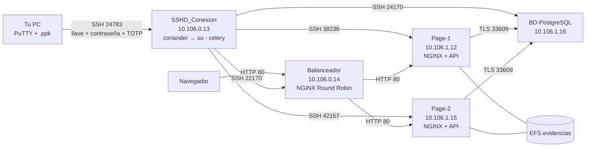

# Práctica 3 · Infraestructura web segura en AWS

Pipeline de GitHub Actions que crea con **Terraform** 5 máquinas Rocky Linux 9 en AWS y las configura con **Ansible** siguiendo la *Guía práctica 3 (Infraestructura web segura)*: un cliente SSH / bastión (`SSHD_Conexion`), un balanceador NGINX Round Robin, dos servidores web (Page-1 y Page-2) con la API EDUTRAK y una base de datos PostgreSQL. El foco es el **hardening de SSH y PAM**: llave RSA 4096 de PuTTYgen + contraseña + TOTP, sin root, sin contraseñas solas y con todo lo que no se usa desactivado.



| Máquina (guía) | IP privada | Subred | Usuario Linux | Puertos |
|---|---|---|---|---|
| **SSHD_Conexion** (SSH-Conection) | 10.106.0.13 | pública | `coriander` (SSH) / `celery` (local) | SSH 24783 solo desde `ADMIN_CIDRS` |
| Balanceador | 10.106.0.14 | pública | `asparagus` | SSH 22170 (bastión); HTTP 80 |
| Page-1 | 10.106.1.12 | privada | `pumpkin` / servicio `broccoli` | SSH 38236 (bastión); 80 (balanceador) |
| Page-2 | 10.106.1.15 | privada | `lettuce` / servicio `spinach` | SSH 42157 (bastión); 80 (balanceador) |
| BD-PostgreSQL (BD-MariaDB) | 10.106.1.16 | privada | `guava` | SSH 24170 (bastión); SQL 33609 (Pages) |

Usuarios y puertos son los de la guía. AWS reserva las IP `.0` a `.3` de cada subred, así que las IP de DigitalOcean (`.2` a `.6`) se movieron sumando 10; los Pages y la BD quedan en una subred **sin IP pública** (salen a Internet por NAT solo para instalar paquetes).

## 1. Antes de ejecutar

### Llave con PuTTYgen (RSA 4096)
1. Abre **PuTTYgen** → *Type of key*: **RSA** → *Number of bits*: **4096** → **Generate**.
2. Escribe una *Key passphrase* (recomendado) → **Save private key** → `mi_llave.ppk`.
3. Abre `mi_llave.ppk` con el Bloc de notas y copia **todo** el contenido.

El pipeline la convierte a OpenSSH con `puttygen` y **rechaza** llaves que no sean RSA de 4096 bits (la guía lo exige y sshd queda con `RequiredRSASize 4096`).

### Secretos y variables del repositorio
*Settings → Secrets and variables → Actions*:

| Tipo | Nombre | Valor |
|---|---|---|
| Secret | `SSH_PRIVATE_KEY` | Contenido completo de `mi_llave.ppk` |
| Secret | `SSH_KEY_PASSPHRASE` | Frase de paso de la `.ppk` (omítelo si no tiene) |
| Secret | `ADMIN_CIDRS` | Tu IP pública con `/32` ([checkip.amazonaws.com](https://checkip.amazonaws.com)); varias separadas por coma |
| Secret | `AWS_ACCESS_KEY_ID` / `AWS_SECRET_ACCESS_KEY` | Credenciales de un usuario IAM (o usa OIDC, abajo) |
| Variable (opcional) | `AWS_ROLE_ARN` | Rol IAM para OIDC; si existe, no se usan llaves de acceso |
| Variable (opcional) | `PROYECTO` | Prefijo de nombres (por defecto `edutrak-p3`) |
| Variable (opcional) | `TF_STATE_BUCKET` | Bucket S3 del estado (por defecto se crea `<proyecto>-tfstate-<cuenta>-<región>`) |
| Variable (opcional) | `APP_ADMIN_NUMERO` | Número del primer ADMIN de la API (por defecto `10000001`) |
| Variable (opcional) | `AMI_ID` | AMI fija de Rocky Linux 9 si en tu región no aparece la oficial (cuenta `792107900819`) |

> La llave privada va como **secreto**, no como entrada del workflow: las entradas de `workflow_dispatch` quedan en texto plano para cualquiera que pueda ver la ejecución, y este repositorio es público.

Permisos que necesita la identidad de AWS: EC2/VPC (instancias, red, grupos de seguridad, NAT, par de llaves), EFS, SSM Parameter Store (`/<proyecto>/*`) y S3 (bucket del estado). El job usa el *environment* `aws-practica3`; en *Settings → Environments* puedes exigir aprobación manual antes de tocar AWS.

## 2. Ejecutar el pipeline

*Actions → infra-aws-practica3 → Run workflow*

| Entrada | Por defecto | Para qué |
|---|---|---|
| `accion` | `plan` | `plan` (solo muestra cambios), `aplicar`, `recrear` (reemplaza las 5 máquinas) o `destruir` |
| `nombre_bastion` | `SSHD_Conexion` | Nombre (etiqueta `Name`) de la máquina cliente SSH; su hostname queda `sshd-conexion` |
| `region` | `us-east-1` | Región de AWS |
| `tipo_instancia` | `t3.micro` | Tipo de las 5 instancias |
| `bloquear_aprovisionamiento` | `true` | Al terminar bloquea la cuenta temporal `ansible`; solo quedan los accesos de la guía |
| `redes_asistencia` | vacío (= `ADMIN_CIDRS`) | `ALLOWED_NETWORKS` de la API (red institucional del QR) |
| `crear_admin_app` | `true` | Crea el primer ADMIN de la API |
| `borrar_secretos` | `false` | Con `destruir`, borra también contraseñas y semillas TOTP de SSM |

Qué hace `aplicar`:
1. Valida Terraform, Ansible (`ansible-lint` perfil *production*) y los scripts.
2. Convierte tu `.ppk` y comprueba RSA 4096.
3. Crea (si no existe) el bucket S3 del estado: privado, cifrado, versionado y solo TLS.
4. `terraform apply`: VPC, subredes, NAT, grupos de seguridad de entrada **y salida**, EFS cifrado y las 5 instancias (IMDSv2, discos cifrados). cloud-init mueve sshd al puerto de la guía (con su etiqueta SELinux `ssh_port_t`) antes de que nadie se conecte.
5. Genera en **SSM Parameter Store** (SecureString) las contraseñas, semillas TOTP, frase de paso de las llaves de `celery`, contraseñas de PostgreSQL y `JWT_SECRET`. Se crean una sola vez y se reutilizan.
6. Compila la API (`api`, `migrate`, `seed`).
7. Abre el puerto SSH del bastión **solo para la IP del runner** y la retira al final, aunque algo falle.
8. Ejecuta `infra/ansible/site.yml` entrando siempre a través del bastión.
9. Corre las pruebas de la guía (abajo) y, si todo pasa, bloquea la cuenta temporal.

El resumen de la ejecución muestra la IP del bastión, la URL de la aplicación y cómo obtener las credenciales.

## 3. Credenciales y TOTP

Cada usuario de la guía tiene **su propia contraseña y su propio TOTP** (`coriander`, `celery`, `asparagus`, `pumpkin`, `lettuce`, `guava`). Para verlos:

```bash
pip install boto3 qrcode
python3 infra/scripts/secretos_lab.py mostrar --proyecto edutrak-p3 --region us-east-1 --qr
```

o en la consola de AWS: *Systems Manager → Parameter Store → `/edutrak-p3/usuarios/<usuario>/…`*. Escanea cada QR (o escribe la semilla) en Google Authenticator, Microsoft Authenticator, Aegis, etc. Los códigos de emergencia de 8 dígitos también están ahí.

## 4. Conectarse con PuTTY (pruebas del capítulo 16)

1. *Session*: Host = IP del bastión (resumen del pipeline), Port = `24783`.
2. *Connection → Data*: Auto-login username = `coriander`.
3. *Connection → SSH → Auth → Credentials*: Private key file = `mi_llave.ppk`.
4. Al conectar: frase de paso de la llave → `Password:` (de coriander) → `Verification code:` (TOTP de coriander).

```bash
# Como coriander
ls -la /home/celery/.ssh/   # Permission denied
ls -la /home/celery/.otp/   # Permission denied
sudo whoami                 # Denegado (coriander no es sudoer)
su - root                   # Denegado (su solo permite coriander -> celery)
su - celery                 # Contraseña de celery + TOTP de celery
# Como celery
sudo -k; sudo whoami        # root (pide la contraseña de celery)
ssh balanceador             # frase de paso de la llave + contraseña y TOTP de asparagus
ssh page1 | ssh page2 | ssh bd
```

Desde tu PC, `celery@IP:24783` y `root@IP:24783` deben ser rechazados. La aplicación: `http://<IP del balanceador>/nodo` alterna **Page-1 / Page-2** (cabeceras `X-Nodo` y `X-Upstream-Server`); `/healthz` y `/readyz` responden JSON de la API.

### Lo que el pipeline ya verifica en cada ejecución
- `sshd -T` en las 5 máquinas: puerto, `ListenAddress` privada, `PermitRootLogin no`, `PasswordAuthentication no`, `AuthenticationMethods publickey,keyboard-interactive:pam`, sin reenvíos, sin X11, sin GSSAPI, sin sftp, sin llave ECDSA.
- Nada escucha en el puerto 22; SELinux en *enforcing*; firewalld sin servicios por defecto.
- Bastión: coriander sin sudo, celery con sudo, coriander no puede leer `~celery/.ssh` ni `~celery/.otp`, celery fuera de `AllowUsers`, llaves privadas en 600.
- Desde fuera: con solo la llave correcta **no** se entra como coriander (falta contraseña + TOTP); celery y root son rechazados.
- Balanceador: 10 peticiones alternan entre Page-1 y Page-2; desde el balanceador la BD **no** es alcanzable.
- Pages: llegan a PostgreSQL, Apache no está instalado, NGINX responde 403 a quien no sea el balanceador, `/readyz` OK.
- BD: escucha solo en `127.0.0.1` y la IP privada en 33609 (nada en `0.0.0.0` ni 5432), TLS activo, la cuenta de la aplicación no es superusuario ni puede crear objetos.

## 5. Hardening de SSH y PAM

**sshd** (`ansible/plantillas/sshd_config.j2`, archivo completo; los fragmentos de `sshd_config.d` de Rocky y cloud-init se retiran):

| Directiva | Valor | Motivo |
|---|---|---|
| `Port` / `ListenAddress` / `AddressFamily` | puerto de la guía / IP privada / `inet` | Sin puerto 22 y sin escuchar en interfaces que no se usan |
| `AuthenticationMethods` | `publickey,keyboard-interactive:pam` | Llave **y** (contraseña + TOTP vía PAM) |
| `PubkeyAcceptedAlgorithms` / `RequiredRSASize` | `rsa-sha2-512,rsa-sha2-256` / `4096` | Solo RSA 4096 con SHA-2 (la guía) |
| `PermitRootLogin`, `PasswordAuthentication`, `PermitEmptyPasswords` | `no` | Sin root ni contraseñas solas |
| `AllowUsers` | bastión: `coriander`; nodos: `<usuario>@10.106.0.13` | Solo los usuarios de la guía y solo desde el bastión |
| `KexAlgorithms`, `Ciphers`, `MACs`, `HostKeyAlgorithms` | curve25519 y DH ≥ 3072 bits, AES-GCM/CTR, HMAC-SHA2-ETM, Ed25519/RSA-SHA2 | Sin SHA-1, CBC, curvas NIST ni ChaCha20 (Terrapin) |
| `AllowTcpForwarding`, `AllowAgentForwarding`, `AllowStreamLocalForwarding`, `X11Forwarding`, `PermitTunnel`, `GatewayPorts` | `no` | Reenvíos que no se usan |
| `GSSAPIAuthentication`, `KerberosAuthentication`, `HostbasedAuthentication`, `PermitUserEnvironment`, `PermitUserRC`, `Compression`, `UseDNS`, `Subsystem sftp` | desactivados | Funciones que no se usan |
| `MaxAuthTries 4`, `LoginGraceTime 60`, `MaxSessions 3`, `ClientAliveInterval 300`, `LogLevel VERBOSE`, `Banner` | — | Límite de intentos, inactividad, huellas en el log y aviso legal |
| Llaves de host | Ed25519 + RSA 4096; ECDSA eliminada y `sshd-keygen@ecdsa` enmascarado | Moduli DH < 3072 bits eliminados |

La cuenta temporal `ansible` tiene un bloque `Match` propio (solo llave, sin terminal, y en el bastión solo reenvío hacia los puertos SSH internos). Con `bloquear_aprovisionamiento=true` ese bloque desaparece y la cuenta queda bloqueada y expirada.

**PAM** (`ansible/roles/pam_endurecido`):
- `authselect` con el perfil de cuentas locales (`local`/`minimal`): **sin** sssd, fprintd ni systemd-homed; funciones `with-faillock`, `with-pwhistory` y `without-nullok` (se verifica que ninguna pila `auth` tenga `nullok`).
- `/etc/pam.d/sshd`: `password-auth` + `pam_google_authenticator.so secret=${HOME}/.otp/.google_authenticator noskewadj` (sin `nullok`). Retirados `pam_namespace` y `pam_motd`.
- `/etc/pam.d/su` del bastión: la configuración definitiva del cap. 15 (solo `coriander` → `celery`, contraseña con `pam_unix` sin `nullok` + `pam_faillock` + TOTP de celery). Retirado `pam_xauth`.
- `/etc/pam.d/su` de los demás nodos: solo root (`pam_wheel` con `wheel` vacío). `remote` niega todo; `chfn`/`chsh` solo root.
- `pam_faillock` (5 fallos / 15 min), `pam_pwquality` (14 caracteres, 4 clases), historial de 5 contraseñas.
- TOTP por usuario en `~/.otp/.google_authenticator` (700/600, etiqueta SELinux `auth_home_t`): `TOTP_AUTH`, `DISALLOW_REUSE`, `WINDOW_SIZE 3`, `RATE_LIMIT 3 30`. La hora se sincroniza con Amazon Time Sync.

## 6. Qué cambia respecto a la guía

| Guía (DigitalOcean) | Este proyecto (AWS) |
|---|---|
| Droplets y VPC 10.106.0.x | EC2 Rocky Linux 9 oficial; subred pública (bastión, balanceador) y privada (Pages, BD), IP +10 |
| Cloud Firewall "no verificado" | Grupos de seguridad de entrada **y salida** por rol, además de firewalld en cada máquina |
| Laravel 12 + PHP-FPM | API EDUTRAK (Go) como servicio systemd con sandbox, usuario `broccoli`/`spinach` sin login, binarios de solo lectura (`bin_t`) |
| MariaDB 11.4 (repo oficial), puerto 33609 | PostgreSQL 16 del repositorio oficial PGDG (llave GPG verificada por huella), mismo puerto 33609, TLS `verify-full`, `pg_hba` por IP exacta |
| Usuario SQL con DDL | Dos cuentas: `edutrak_migrator` (dueña del esquema, solo desde Page-1) y `edutrak_app` (solo DML) — la recomendación del cap. 20 |
| Sesión compartida en BD / error 419 | JWT con el mismo `JWT_SECRET` en ambos Pages; evidencias en EFS compartido (mismo UID en ambos nodos) |
| `APP_NAME` para ver el nodo | `/nodo` y cabecera `X-Nodo` en NGINX, sin tocar la configuración de la API |
| Llaves y huellas aceptadas a mano | `known_hosts` de celery con las huellas Ed25519 reales; llaves con frase de paso y `from="10.106.0.13",restrict` |

**Pendiente (igual que en la guía):** HTTPS en el balanceador requiere un dominio; hoy la entrada web es HTTP en el puerto 80. El tráfico NFS hacia EFS va dentro de la VPC sin TLS (montar con `amazon-efs-utils` lo cifraría).

## 7. Operación

- **Volver a ejecutar:** con `bloquear_aprovisionamiento=false` puedes repetir `aplicar` cuantas veces quieras. Con `true`, la cuenta temporal ya no existe: usa `recrear` (las contraseñas y TOTP de SSM se conservan; los datos de la BD no).
- **Costos:** el NAT Gateway, las IP públicas y las 5 instancias cobran por hora. Ejecuta `destruir` al terminar.
- **Recuperación:** si un cambio te deja fuera, usa la *EC2 Serial Console* (debe habilitarse en la cuenta) con `coriander`/`celery` y su contraseña. Los archivos originales de SSH, PAM y PostgreSQL quedan en `/root/respaldos-practica-3/`. El *rollback* de `su` del cap. 16 aplica igual.
- **Desde tu PC** (sin GitHub Actions): `terraform init -backend-config=backend.hcl` con las mismas variables de `terraform.tfvars.example`, luego `generar_inventario.py`, `secretos_lab.py asegurar` y `ansible-playbook site.yml -e @secretos.json -e @despliegue.json` (mira el paso *Ansible* del workflow).

## Estructura

```
.github/workflows/infra-aws.yml   pipeline (validar + plan/aplicar/recrear/destruir)
infra/terraform/                  red, grupos de seguridad, EC2, EFS, cloud-init
infra/ansible/site.yml            orden de los roles y pruebas
infra/ansible/roles/              comun, usuarios, pam_endurecido, ssh_endurecido, basedatos,
                                  nginx_base, servidor_web, balanceador, bastion, verificacion, cierre
infra/scripts/                    preparar_llave.sh (.ppk → OpenSSH), secretos_lab.py (SSM),
                                  generar_inventario.py (Terraform → inventario)
```
